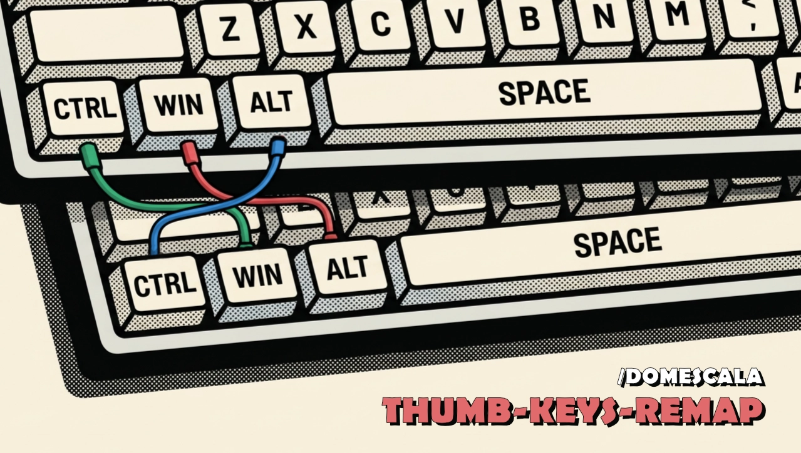
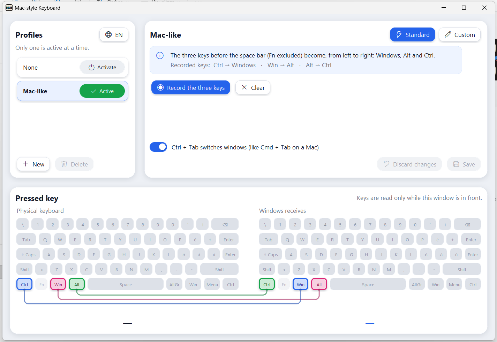
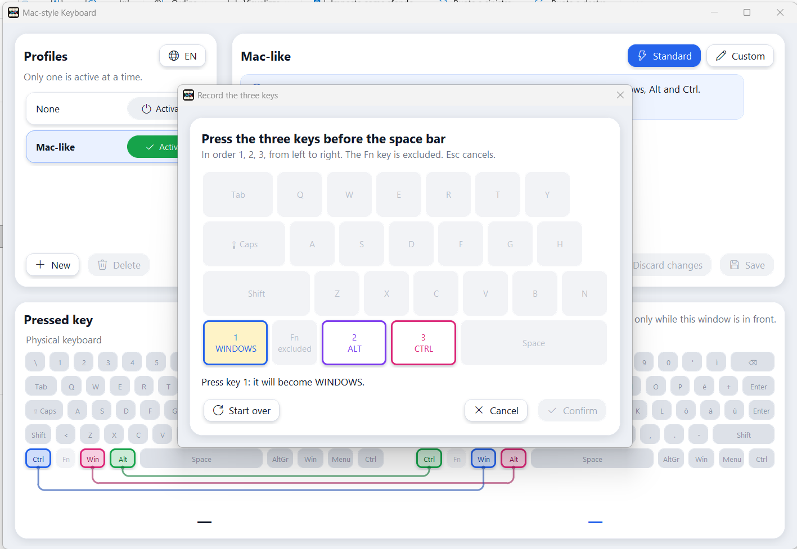

[](./README.md)

<div align="center">

<br/>
<br/>

# Mac-like Keyboard Remap for Windows

**Rimappa i tasti <kbd>WIN</kbd> <kbd>ALT</kbd> <kbd>CTRL</kbd> di Windows per adattarli al layout del Mac.**
La mappatura si applica tramite PowerToys Keyboard Manager di Windows, si può attivare o disattivare in qualsiasi momento senza dover riavviare.

<br/>

     

</div>

<br/>

## Screenshots

<table><tr>
    <td></td>
     <td></td>
  </tr>
</table>


## Contenuto

<table>
  <tr>
    <td width="33%" valign="top">
    <h4> <a href="#configurazioni">Mac-like</a></h4>
    Lista delle configurazioni:
    <code>Nessuna</code> · <code>Mac-like</code> · Più quelle che creerai tu<br/><br/></td>
    <td width="33%" valign="top">
    <h4> <a href="#configurazione-rapida">Configurazione rapida</a></h4>
    Premi in ordine i tre tasti prima dello spazio e hai finito.<br/><br/></td>
  </tr>
  <tr>
    <td width="33%" valign="top">
    <h4> <a href="#personalizza">Personalizza</a></h4>
    Scegli tu, riga per riga, il tasto di partenza e quello di arrivo.<br/><br/></td>
    <td valign="top">
    <h4> <a href="#altgr">AltGr Issue risolto</a></h4>
    </td>
  </tr>
  <tr>
    <td valign="top">
    <h4> <a href="#tastiera-in-tempo-reale">Anteprima Tastiera</a></h4>
    <br/></td>
    <td valign="top">
    <h4> <a href="#lingue">Lingue</a></h4>
    Italiano e inglese<br/><br/></td>
  </tr>
</table>

<br/>

## Installazione

Serve **Windows 11**.

### 1️⃣ Installa PowerToys

```powershell
winget install --id Microsoft.PowerToys
```

### 2️⃣ Scarica e avvia il programma

#### Via eseguibile

Scarica **`MacLikeKeyboard.exe`** dall'[ultima release](https://github.com/domescala/windows-mac-like-keyboard-remap/releases/latest) e aprilo. Non c'è niente da installare: Python non serve.

- Mettilo in una cartella in cui puoi scrivere (non in `Programmi`): le configurazioni vengono salvate accanto, in `configurations.json`.
- Per aggiornarlo sostituisci l'exe e conserva `configurations.json`.

> [!NOTE]
> L'exe non è firmato: se compare l'avviso di Windows SmartScreen, premi `Ulteriori informazioni` e poi `Esegui comunque`.

---

#### Via terminale

> [!NOTE]
> È richiesto Python 3.

##### Scarica la repository

Con git:

```powershell
git clone https://github.com/domescala/windows-mac-like-keyboard-remap.git
```

Oppure scarica lo [ZIP](https://github.com/domescala/windows-mac-like-keyboard-remap/archive/refs/heads/main.zip) ed estrailo.

##### Installa Pillow

Dal terminale spostati nella cartella e installa Pillow:

```powershell
cd windows-mac-like-keyboard-remap
python -m pip install pillow
```

Se hai scaricato lo ZIP, la cartella si chiama `windows-mac-like-keyboard-remap-main`.

##### Avvia

```powershell
python app.py
```

Con `pythonw app.py` si apre senza la finestra del terminale.

---

### 3️⃣ Attiva

Premi `Attiva` accanto a **Mac-like**. Keyboard Manager viene acceso da solo, se era spento.

La finestra si può chiudere: la mappatura resta valida finché PowerToys è in esecuzione. Per tornare alla tastiera originale attiva **Nessuna**.

> [!WARNING]
> Attivare una configurazione **sostituisce** le rimappature e le scorciatoie già presenti in Keyboard Manager. La prima volta il programma ne salva una copia in `%LOCALAPPDATA%\Microsoft\PowerToys\Keyboard Manager\backup-mac-keyboard`.

<br/>

---

<br/>

## Configurazioni

L'elenco a sinistra. **Ne è attiva una sola per volta** (`In uso`).

| Configurazione | Cosa fa                                                                    |
| -------------- | -------------------------------------------------------------------------- |
| **Nessuna**    | La tastiera resta originale                                                |
| **Mac-like**   | I tre tasti prima dello spazio diventano Windows, Alt e Ctrl, come sul Mac |
| **Le tue**     | `Nuova` ne crea una con il nome che vuoi                                   |

La configurazione **Mac-like** su una tastiera PC:

| Posizione | Tasto sulla tastiera | Diventa         |
| :-------: | -------------------- | --------------- |
|     1     | <kbd>CTRL</kbd>      | <kbd>WIN</kbd>  |
|     2     | <kbd>WIN</kbd>       | <kbd>ALT</kbd>  |
|     3     | <kbd>ALT</kbd>       | <kbd>CTRL</kbd> |

Così <kbd>CTRL</kbd> finisce sotto il pollice, dove sul Mac c'è <kbd>⌘ Command</kbd>.

- Tutte le configurazioni si possono modificare; **Nessuna** e **Mac-like** non si possono eliminare.
- Per eliminare quella attiva, prima attivane un'altra.
- `Salva` sulla configurazione in uso la applica subito.

> [!TIP]
> Se i tuoi tre tasti sono in un altro ordine (per esempio una tastiera Apple: <kbd>CTRL</kbd> <kbd>ALT</kbd> <kbd>WIN</kbd>), usa **Configurazione rapida** e registrali.

### Ctrl + Tab

L'opzione `Ctrl + Tab cambia finestra` lo trasforma in <kbd>ALT</kbd> + <kbd>TAB</kbd>, come <kbd>⌘</kbd> + <kbd>Tab</kbd> sul Mac. In **Mac-like** è già accesa.

> [!NOTE]
> Con l'opzione accesa, <kbd>Ctrl sinistro</kbd> + <kbd>Tab</kbd> non cambia più scheda nel browser e negli editor.

<br/>

## Configurazione rapida

 I tre tasti prima della barra spaziatrice (escluso <kbd>Fn</kbd>) diventano, da sinistra a destra, <kbd>WIN</kbd> <kbd>ALT</kbd> <kbd>CTRL</kbd>.

1. Premi `Registra i tre tasti`.
2. Premi i tasti **nell'ordine 1, 2, 3**, da sinistra a destra: sono accettati solo <kbd>Ctrl</kbd>, <kbd>Windows</kbd> (<kbd>Cmd</kbd>) e <kbd>Alt</kbd> (<kbd>Option</kbd>) di sinistra.
3. `Conferma` (o `Invio`), poi `Salva`.

`Esc` annulla, `Ricomincia` riparte dal primo tasto, `Svuota` cancella la registrazione.

<br/>

## Personalizza

 Ogni riga è una rimappatura: **tasto di partenza → tasto di arrivo**.

- Scegli i tasti dall'elenco, oppure premi il pulsante con la tastiera e poi il tasto.
- Come arrivo puoi scegliere `Disattivato` per spegnere un tasto.
- `Aggiungi riga` per un'altra rimappatura.
- Non si salva con righe incomplete, con partenza e arrivo uguali o con lo stesso tasto di partenza usato due volte.

<br/>

## Tastiera in tempo reale

 In basso ci sono due tastiere uguali: a sinistra la **Tastiera reale**, a destra la **Tastiera virtuale**, cioè quello che arriva a Windows.

| Come appare   | Cosa significa                                |
| ------------- | --------------------------------------------- |
| Stesso colore | La coppia di tasti rimappati                  |
| Filo colorato | Collega il tasto premuto al tasto che diventa |
| Tasto scuro   | Non è toccato dalla mappatura                 |
| `✕`           | Tasto disattivato                             |

Premendo un tasto si accende su entrambe le tastiere, con il nome scritto sotto.

> [!NOTE]
> I tasti vengono letti **solo con la finestra in primo piano**.

<br/>

## AltGr

 Per Windows <kbd>AltGr</kbd> è <kbd>Ctrl sinistro</kbd> + <kbd>Alt destro</kbd>: spostando il <kbd>CTRL</kbd> si romperebbe. Il programma legge il layout in uso e aggiunge in PowerToys una scorciatoia per ogni carattere di <kbd>AltGr</kbd>, che così continua a funzionare.

- Funziona quando il <kbd>Ctrl sinistro</kbd> diventa <kbd>Windows</kbd>. Se una configurazione lo trasforma in un altro tasto, compare un avviso.
- Il layout viene letto all'avvio: se lo cambi, riavvia il programma e premi di nuovo `Attiva`.

<br/>

## Lingue

 Il pulsante con il mappamondo passa alla lingua successiva. Alla prima apertura è quella di Windows.

I testi sono nei file di `locales/`:

- **modificare un testo**: cambialo in `it.json` o `en.json`, i file vengono riletti a ogni cambio di lingua;
- **aggiungere una lingua**: copia `en.json` (per esempio in `fr.json`) e traducilo;
- le parti tra graffe, come `{key}`, vanno lasciate così. Un testo mancante compare in inglese.

Nell'exe i testi sono incorporati: per cambiarli avvia il programma [via terminale](#via-terminale) o rigenera l'exe.

<br/>

## Creare l'exe

Serve **Python 3**. Dalla cartella del progetto:

```powershell
powershell -ExecutionPolicy Bypass -File build.ps1
```

Il risultato è `dist\MacLikeKeyboard.exe`. Lo script scarica Pillow e PyInstaller in un ambiente separato dentro `build/`, quindi la prima volta serve la connessione a Internet.

<br/>

## File e salvataggio

| File                  | Cosa contiene                                                                 |
| --------------------- | ----------------------------------------------------------------------------- |
| `app.py`              | La finestra                                                                   |
| `mapping.py`          | Tasti, configurazioni e conversione nel formato di PowerToys                  |
| `winapi.py`           | Lettura della tastiera, layout e PowerToys                                    |
| `widgets.py`          | Pulsanti, riquadri e tastiere disegnate                                       |
| `i18n.py`, `locales/` | Traduzioni                                                                    |
| `assets/`             | L'icona del programma                                                         |
| `build.ps1`           | Crea l'exe                                                                    |
| `configurations.json` | Le tue configurazioni e la lingua: creato accanto al programma, non va in git |

<br/>

## Limiti noti

- La mappatura vale per **tutte le tastiere** collegate: non si può averne una diversa per ciascuna.
- Il tasto <kbd>Fn</kbd> non si può rimappare.
- Nelle finestre aperte come amministratore la mappatura vale solo se anche PowerToys è eseguito come amministratore.
- Nella schermata di accesso di Windows i tasti restano quelli originali.

<br/>

> [!NOTE]
> Se vuoi solo rimappare i tasti CTRL e ALT come su un Mac, questa è una valida alternativa agli script AutoHotkey (AHK) e a SharpKeys: non serve scrivere script né modificare il registro. La mappatura è gestita da PowerToys Keyboard Manager di Microsoft. Rispetto a SharpKeys, non occorre riavviare a ogni modifica.

<br/>

<div align="center">

<sub>

_Provato con PowerToys 0.100.2._

</sub>

</div>
