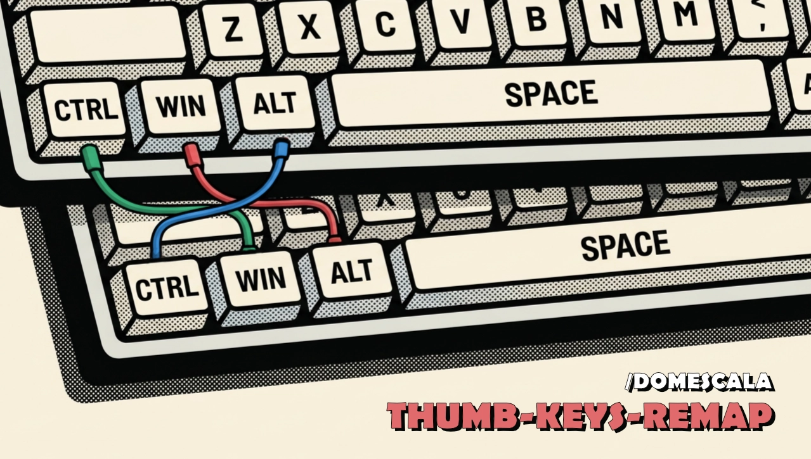
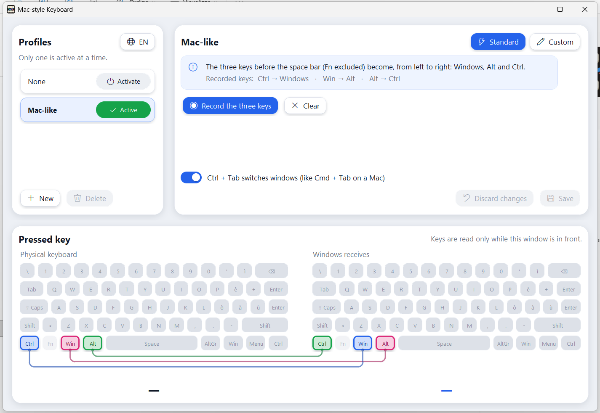
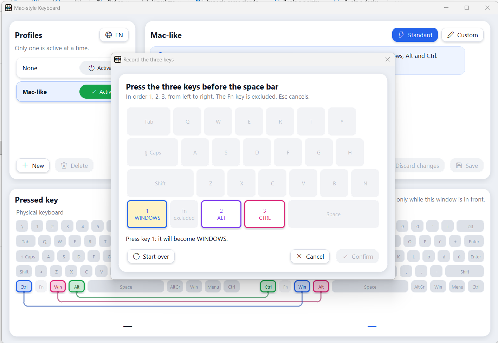

[](./README.it.md)

<div align="center">

<br/>
<br/>

# Mac-like Keyboard Remap for Windows

**Remap the <kbd>WIN</kbd> <kbd>ALT</kbd> <kbd>CTRL</kbd> keys on Windows to match the Mac layout.**
The mapping is applied through the Windows PowerToys Keyboard Manager and can be turned on or off at any time, without restarting.

<br/>

     


</div>

<br/>

## Screenshots

<table><tr>
    <td></td>
     <td></td>
  </tr>
</table>


## Contents

<table>
  <tr>
    <td width="33%" valign="top">
    <h4> <a href="#profiles">Mac-like</a></h4>
    List of profiles:
    <code>None</code> · <code>Mac-like</code> · Plus the ones you create<br/><br/></td>
    <td width="33%" valign="top">
    <h4> <a href="#standard-mode">Standard mode</a></h4>
    Press the three keys before the space bar in order, and you're done.<br/><br/></td>
  </tr>
  <tr>
    <td width="33%" valign="top">
    <h4> <a href="#custom-mode">Custom mode</a></h4>
    Choose the original key and the new key yourself, row by row.<br/><br/></td>
    <td valign="top">
    <h4> <a href="#altgr">AltGr issue solved</a></h4>
    </td>
  </tr>
  <tr>
    <td valign="top">
    <h4> <a href="#live-keyboard">Keyboard preview</a></h4>
    <br/></td>
    <td valign="top">
    <h4> <a href="#languages">Languages</a></h4>
    Italian and English<br/><br/></td>
  </tr>
</table>

<br/>

## Installation

You need **Windows 11**.

### 1️⃣ Install PowerToys

```powershell
winget install --id Microsoft.PowerToys
```

### 2️⃣ Download and run the app

#### Using the executable

Download **`MacLikeKeyboard.exe`** from the [latest release](https://github.com/domescala/windows-mac-like-keyboard-remap/releases/latest) and open it. There is nothing to install: Python is not needed.

- Put it in a folder you can write to (not `Program Files`): your profiles are saved next to it, in `configurations.json`.
- To update, replace the exe and keep `configurations.json`.

> [!NOTE]
> The exe is not signed: if the Windows SmartScreen warning appears, press `More info` and then `Run anyway`.

---

#### Using the terminal

> [!NOTE]
> Python 3 is required.

##### Download the repository

With git:

```powershell
git clone https://github.com/domescala/windows-mac-like-keyboard-remap.git
```

Or download the [ZIP](https://github.com/domescala/windows-mac-like-keyboard-remap/archive/refs/heads/main.zip) and extract it.

##### Install Pillow

In the terminal, move into the folder and install Pillow:

```powershell
cd windows-mac-like-keyboard-remap
python -m pip install pillow
```

If you downloaded the ZIP, the folder is named `windows-mac-like-keyboard-remap-main`.

##### Run

```powershell
python app.py
```

Use `pythonw app.py` to open it without the terminal window.

---

### 3️⃣ Activate

Press `Activate` next to **Mac-like**. Keyboard Manager is turned on automatically if it was off.

You can close the window: the mapping stays in place as long as PowerToys is running. To go back to the original keyboard, activate **None**.

> [!WARNING]
> Activating a profile **replaces** the key and shortcut remappings already set in Keyboard Manager. The first time, the program saves a copy of them in `%LOCALAPPDATA%\Microsoft\PowerToys\Keyboard Manager\backup-mac-keyboard`.

<br/>

---

<br/>

## Profiles

The list on the left. **Only one is active at a time** (`Active`).

| Profile      | What it does                                                          |
| ------------ | --------------------------------------------------------------------- |
| **None**     | The keyboard stays as it is                                           |
| **Mac-like** | The three keys before the space bar become Windows, Alt and Ctrl, as on a Mac |
| **Yours**    | `New` creates one with the name you want                              |

The **Mac-like** profile on a PC keyboard:

| Position | Key on the keyboard | Becomes         |
| :------: | ------------------- | --------------- |
|    1     | <kbd>CTRL</kbd>     | <kbd>WIN</kbd>  |
|    2     | <kbd>WIN</kbd>      | <kbd>ALT</kbd>  |
|    3     | <kbd>ALT</kbd>      | <kbd>CTRL</kbd> |

This puts <kbd>CTRL</kbd> under your thumb, where a Mac has <kbd>⌘ Command</kbd>.

- All profiles can be edited; **None** and **Mac-like** cannot be deleted.
- To delete the active profile, activate another one first.
- `Save` on the active profile applies it immediately.

> [!TIP]
> If your three keys are in a different order (for example on an Apple keyboard: <kbd>CTRL</kbd> <kbd>ALT</kbd> <kbd>WIN</kbd>), use **Standard mode** and record them.

### Ctrl + Tab

The `Ctrl + Tab switches windows` option turns it into <kbd>ALT</kbd> + <kbd>TAB</kbd>, like <kbd>⌘</kbd> + <kbd>Tab</kbd> on a Mac. It is already on in **Mac-like**.

> [!NOTE]
> With the option on, <kbd>Left Ctrl</kbd> + <kbd>Tab</kbd> no longer switches tabs in browsers and editors.

<br/>

## Standard mode

 The three keys before the space bar (<kbd>Fn</kbd> excluded) become, from left to right, <kbd>WIN</kbd> <kbd>ALT</kbd> <kbd>CTRL</kbd>.

1. Press `Record the three keys`.
2. Press the keys **in order 1, 2, 3**, from left to right: only the left <kbd>Ctrl</kbd>, <kbd>Windows</kbd> (<kbd>Cmd</kbd>) and <kbd>Alt</kbd> (<kbd>Option</kbd>) keys are accepted.
3. `Confirm` (or `Enter`), then `Save`.

`Esc` cancels, `Start over` goes back to the first key, `Clear` erases the recording.

<br/>

## Custom mode

 Each row is one remapping: **original key → new key**.

- Pick the keys from the list, or press the keyboard button and then the key.
- As the new key you can choose `Disabled` to turn a key off.
- `Add row` for another remapping.
- You cannot save with incomplete rows, with the same key as original and new, or with the same original key used twice.

<br/>

## Live keyboard

 At the bottom there are two identical keyboards: the **Physical keyboard** on the left, and on the right what **Windows receives**.

| How it looks  | What it means                               |
| ------------- | ------------------------------------------- |
| Same color    | A pair of remapped keys                     |
| Colored wire  | Connects the pressed key to the key it becomes |
| Dark key      | Not affected by the mapping                 |
| `✕`           | Disabled key                                |

A pressed key lights up on both keyboards, with its name written below.

> [!NOTE]
> Keys are read **only while the window is in front**.

<br/>

## AltGr

 To Windows, <kbd>AltGr</kbd> is <kbd>Left Ctrl</kbd> + <kbd>Right Alt</kbd>: moving <kbd>CTRL</kbd> would break it. The program reads the current layout and adds a PowerToys shortcut for every <kbd>AltGr</kbd> character, so it keeps working.

- It works when <kbd>Left Ctrl</kbd> becomes <kbd>Windows</kbd>. If a profile turns it into another key, a warning is shown.
- The layout is read at startup: if you change it, restart the program and press `Activate` again.

<br/>

## Languages

 The globe button switches to the next language. On first launch the app uses the Windows language.

The texts are in the files in `locales/`:

- **to edit a text**: change it in `it.json` or `en.json`; the files are read again at every language change;
- **to add a language**: copy `en.json` (for example to `fr.json`) and translate it;
- leave the parts in braces, such as `{key}`, as they are. A missing text is shown in English.

The texts are built into the exe: to change them, run the program [from the terminal](#using-the-terminal) or build the exe again.

<br/>

## Build the exe

You need **Python 3**. From the project folder:

```powershell
powershell -ExecutionPolicy Bypass -File build.ps1
```

The result is `dist\MacLikeKeyboard.exe`. The script downloads Pillow and PyInstaller into a separate environment inside `build/`, so the first run needs an Internet connection.

<br/>

## Files and saving

| File                  | What it contains                                                        |
| --------------------- | ----------------------------------------------------------------------- |
| `app.py`              | The window                                                              |
| `mapping.py`          | Keys, profiles and conversion to the PowerToys format                   |
| `winapi.py`           | Keyboard reading, layout and PowerToys                                  |
| `widgets.py`          | Buttons, panels and drawn keyboards                                     |
| `i18n.py`, `locales/` | Translations                                                            |
| `assets/`             | The program icon                                                        |
| `build.ps1`           | Builds the exe                                                          |
| `configurations.json` | Your profiles and language: created next to the program, ignored by git |

<br/>

## Known limits

- The mapping applies to **all connected keyboards**: you cannot have a different one for each.
- The <kbd>Fn</kbd> key cannot be remapped.
- In windows running as administrator, the mapping works only if PowerToys is also run as administrator.
- On the Windows sign-in screen the keys keep their original functions.

<br/>

> [!NOTE]
> If you only want to remap the CTRL-ALT keys as on a Mac, this is a good alternative to AutoHotkey (AHK) scripts and SharpKeys: no scripting or registry editing needed. The mapping is handled by Microsoft's PowerToys Keyboard Manager. Unlike SharpKeys, you don't need to restart after each change.

<br/>

<div align="center">

<sub>

_Tested with PowerToys 0.100.2._

</sub>

</div>
